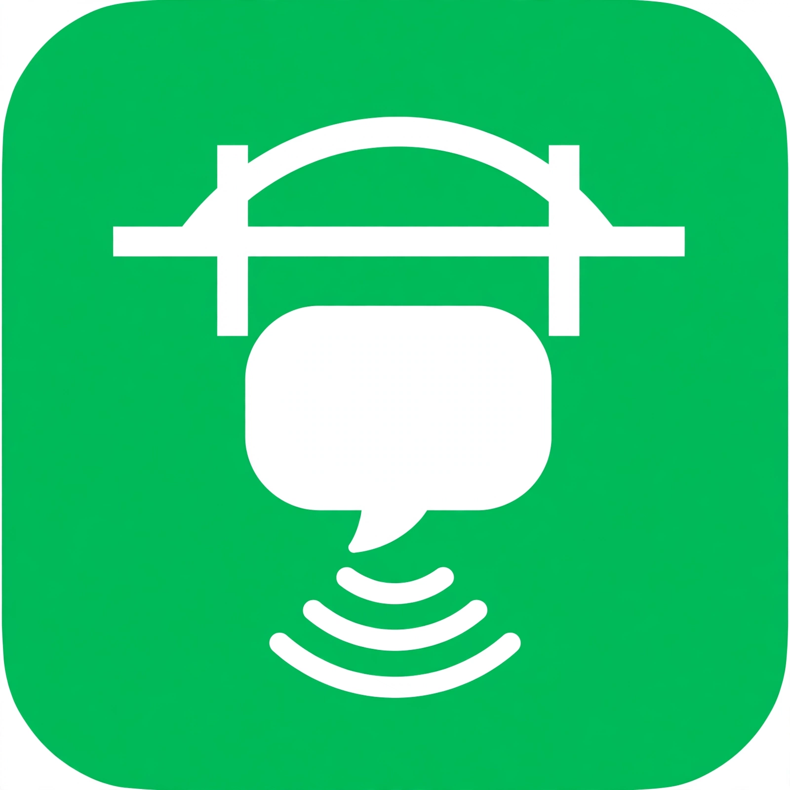

# wechat-bridge

<p align="center">
  
</p>

                                       **把微信接到你的个人 AI 助手（Muse 等）。**

[](https://www.python.org/)
[](https://github.com/Liu-zhongxian/wechat-bridge)
[](https://github.com/Liu-zhongxian/wechat-bridge)
[](https://ilinkai.weixin.qq.com/)
[](https://github.com/Liu-zhongxian/wechat-bridge)
[](LICENSE)

微信消息经腾讯官方 [ClawBot / iLink](https://ilinkai.weixin.qq.com/) 进入本机 `wechat-bridge`，转成 JSON 落盘到 `inbox/`；你的 Agent 读取后，用 `send` 发回微信。

---

## 功能

- **双向收发**：收文本、图片、语音、文件、视频；回发文本、图片、文件、视频。语音附带微信转写文本。
- **只出站**：走 iLink 长轮询，不对外开端口。
- **媒体加解密**：微信 CDN 媒体 AES-128-ECB 解密下载；发送时加密上传。
- **指数退避**：getupdates 失败 2 秒重试，连续 3 次失败后退避到 30 秒。
- **文本分片**：超 2000 字自动切多条发出。
- **二维码自动刷新**：`wait-login` 遇到过期自动重取，最多 3 次。

```
+--------+   iLink getupdates   +--------------+   inbox/ JSON   +---------+
|        | -------------------> |              | --------------> |         |
| WeChat |                      | wechat-bridge|                 |  Agent  |
|        | <------------------- |              | <-------------- |         |
+--------+   iLink sendmessage  +--------------+  outbox/pending +---------+ 
```

## 架构

```
wechat_bridge/
  ilink.py    # 协议层：登录、收发消息、headers、文本分片
  crypto.py   # 加解密：AES-128-ECB、aes_key 解析、多策略暴力解密
  media.py    # 媒体：CDN 上传下载
  store.py    # 状态：路径管理、原子读写、会话（0600 权限）
  serve.py    # 业务层：长轮询、指数退避、去重、outbox 发送
  cli.py      # 命令行入口
tests/
  test_crypto.py
```

## 快速开始

```bash
pip install qrcode pycryptodome
pip install -e .

wechat-bridge login        # 终端出二维码，微信扫码
wechat-bridge wait-login   # 等待确认（二维码过期自动刷新 3 次）

# 先用微信给 Bot 发一条消息（官方限制：必须用户先发才有 context_token）
nohup wechat-bridge serve &

wechat-bridge send --text "你好"
wechat-bridge send --image ./a.jpg --text "见图"
wechat-bridge send --video ./b.mp4
wechat-bridge status
```

数据目录默认 `~/workspace/wechat-bridge`，可用环境变量 `WECHAT_BRIDGE_DIR` 覆盖。

## 媒体加解密

微信 CDN 媒体为 AES-128-ECB + PKCS7 加密。`aes_key` 有 4 种格式（16 字节原文 / 32 hex / base64 / base64 包 hex），严格解析（标准 + URL 安全 base64）。

**坑**：视频下载必须用 `encrypt_query_param` 拼的 CDN 地址，`full_url` 返回的数据解密会失败。解密失败时自动尝试多种密钥派生 × 模式组合。

## 测试

```bash
python3 tests/test_crypto.py
```

## 限制（微信官方）

- 仅一对一私聊，不支持群聊
- 助手不能主动发起会话，用户必须先发消息
- 连续约 10 条不回复会被限流，用户回一句重置
- 二维码有效期约 2 分钟

## 致谢

媒体收发与分层思路参考 [lawrencewzen/wx-bot](https://github.com/lawrencewzen/wx-bot)（Go 实现）。

MIT License.
